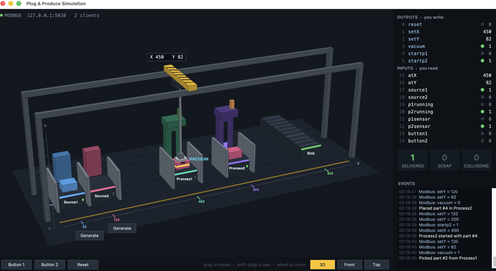
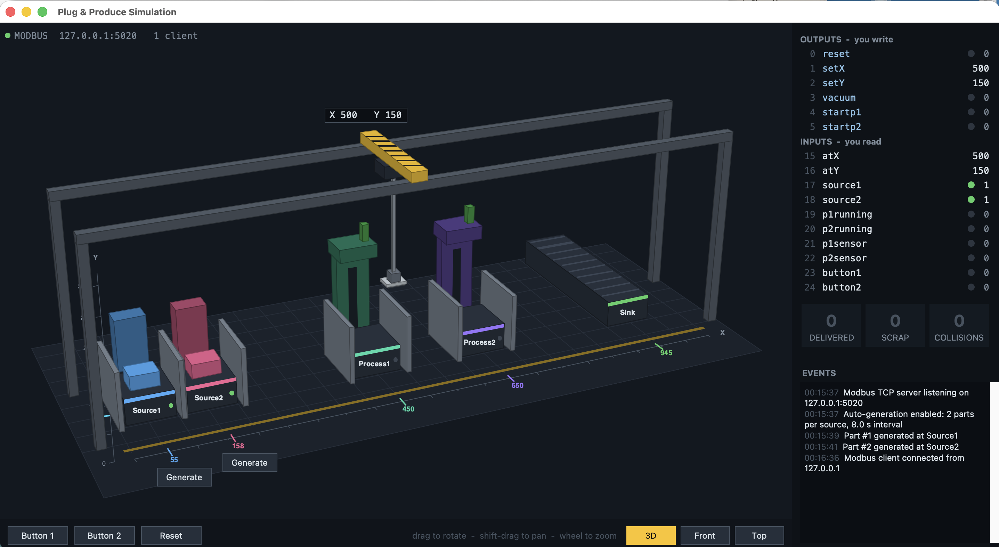
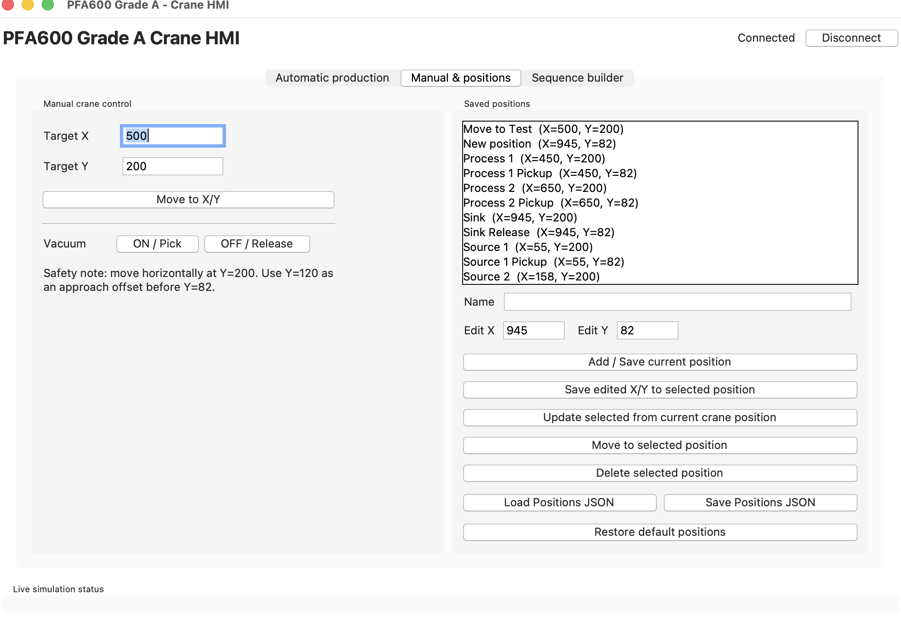
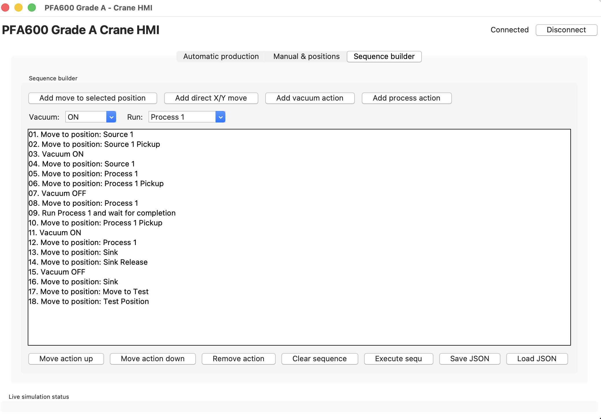

# Industrial Crane Automation and HMI Using Python & Modbus TCP

**PFA600 – Programming for Automation | University West, Sweden**

A Python-based industrial automation project developed around a **plug-and-produce manufacturing cell** with a movable crane, vacuum gripper, two material sources, two processing stations, and a delivery sink. The work progresses from JSON-driven crane movements through sensor-based control and production logging to a **Tkinter human–machine interface (HMI)** and dual-route automatic material handling.

The controllers communicate with a local simulation through **Modbus TCP**. The simulator used in the coursework was provided by the course instructor; it is **not included in this public-facing package** pending redistribution permission.

## Project highlights

- **Modbus TCP integration:** read station sensors, crane coordinates and processing status; write target coordinates, vacuum commands and process-start signals.
- **Five levels of implementation:** from scripted sequences (Grade E) to operator-facing HMI (Grade A).
- **Collision-aware routing:** move vertically to a configured safe height before horizontal travel.
- **Sensor-driven workflows:** check material presence, vacuum state, station occupancy and process completion.
- **Traceability:** log product identifiers, timestamps, crane positions and vacuum status as CSV records.
- **Dual production paths:** process both Type 1 and Type 2 parts, with controller logic for different routes.
- **Operator interface:** manual crane controls, live position feedback, configurable named positions, editable sequences and production controls.
- **Automatic generation support:** the extended simulator variant adds configurable part generation for testing; see the note on simulator availability below.


## Project Demonstration

### Automatic Production HMI


The Grade A interface provides controls for
monitoring and managing automatic crane operation.

### Crane Simulation


The simulation demonstrates crane movement and
material handling using Modbus TCP communication.

### Manual Control Interface


Manual controls allow users to interact with
the crane's positioning system.

### Sequence Builder


The sequence builder provides an interface for
managing crane motion instructions.

## Technologies

| Component | Technology |
|---|---|
| Programming | Python |
| Industrial communication | Modbus TCP via `pymodbus` 3.8.6 |
| Graphical user interface | Tkinter / ttk |
| Sequence configuration | JSON |
| Production reporting | CSV |
| Target environment | Local plug-and-produce crane simulator |

## Implementation levels

| Level | Main file | Function |
|---|---|---|
| **Grade E** | `grade_e_controller.py` | Executes a predefined action sequence loaded from `grade_e_actions.json`, including movement and vacuum commands. |
| **Grade D** | `grade_d_controller.py` | Executes a sensor-aware Source 1 → Process 1 → Sink production sequence with process-completion checks. |
| **Grade C** | `grade_c_controller.py` | Extends the automated sequence with timestamped product-location CSV logging. |
| **Grade B** | `grade_b_auto_controller.py` | Automatically handles two types of products using station and process state monitoring, with CSV logging. |
| **Grade A** | `grade_a_hmi.py` | Tkinter HMI for manual operation, named positions, saved action sequences, monitoring, and launching/stopping the automatic controller. |

## Process flow

**Type 1**

```text
Source 1 → Process 1 → Sink
```

**Type 2**

```text
Source 2 → Process 2 → Process 1 → Sink
```

The crane raises the gripper to a safe travel height before lateral movement, approaches station locations for part pickup/drop-off, and uses sensor feedback to decide whether operations can proceed.

## Architecture

```text
                  Operator
                     │
             Tkinter Grade A HMI
                     │
        ┌────────────┴────────────┐
        │                         │
  Manual / JSON actions      Grade B controller
        │                         │
        └────────────┬────────────┘
                     │
             PyModbus TCP client
                     │
            127.0.0.1 : 5020
                     │
       Plug-and-produce simulator
       (provided separately by course)
                     │
          Crane, sources, processes,
           sensors and delivery sink
```

**Important:** run only one crane controller at a time. The HMI includes safeguards against concurrent manual and automatic operation, but this is an educational simulation and not a certified industrial safety system.

## Repository structure

```text
.
├── README.md
├── GITHUB_REPOSITORY_DETAILS.md
├── requirements.txt
├── .gitignore
├── grade_e_controller.py
├── grade_e_actions.json
├── grade_d_controller.py
├── grade_c_controller.py
├── grade_b_auto_controller.py
├── grade_a_hmi.py
├── grade_a_positions.json
└── grade_a_complete_sequence.json
```

The following simulator files are **not distributed here** until permission is confirmed:

- `plug_and_produce_simulation.py` — course-provided original simulator.
- `plug_and_produce_simulation_auto.py` — extended simulator incorporating automatic part generation.

## Local setup

**Prerequisites:** Python with Tkinter enabled, `pip`, and authorized access to the compatible PFA600 plug-and-produce simulator. The project was developed using Python 3.15 and `pymodbus` 3.8.6; other Python versions are not verified here.

1. Clone the repository and open it in a terminal:

   ```bash
   git clone https://github.com/Charlesnd/python-modbus-crane-automation.git
   cd python-modbus-crane-automation
   ```

2. Create and activate a virtual environment:

   ```bash
   python3 -m venv .venv
   source .venv/bin/activate
   python3 -m pip install -r requirements.txt
   ```

   On Windows, activate with `.venv\Scripts\activate` and use `python` in place of `python3` where appropriate.

3. Obtain the authorized course simulator and place it alongside the controller scripts. Start the **original** simulator in a separate terminal, explicitly using port `5020`:

   ```bash
   python3 plug_and_produce_simulation.py --port 5020
   ```

4. In another terminal, with the virtual environment active, run **one** controller:

   ```bash
   python3 grade_a_hmi.py
   ```

   Or, to test individual levels, choose one of:

   ```bash
   python3 grade_e_controller.py
   python3 grade_d_controller.py
   python3 grade_c_controller.py
   python3 grade_b_auto_controller.py
   ```

5. In Grade A, connect to the simulator at `127.0.0.1:5020`, then use the HMI to control crane movements or build/load a sequence. The `grade_a_complete_sequence.json` file is an example sequence for the HMI.

### Optional automatic-production demonstration

The HMI's **Launch auto simulator** feature specifically expects `plug_and_produce_simulation_auto.py` alongside the HMI. This variant is not distributed here pending permission. If you have authorized access, it can be launched with:

```bash
python3 plug_and_produce_simulation_auto.py --port 5020 --auto-generate 2 --auto-interval 8
```

Alternatively, after confirming simulator and HMI are not connected, use the HMI's **Launch auto simulator** control, reconnect, and start automatic production. The HMI offers a **Stop after transfer** option; this is a graceful stop, **not an emergency stop**.

**Note:** Grade B needs available parts to process. The ordinary simulator may require manually generating parts; the auto variant was added to support repeated demonstrations.

## Modbus register map

The simulator provides these relevant holding registers:

| Address | Signal | Purpose |
|---:|---|---|
| 0 | `reset` | Stop/reset processing control |
| 1 | `setX` | Target horizontal coordinate |
| 2 | `setY` | Target vertical coordinate |
| 3 | `vacuum` | Gripper ON/OFF |
| 4 | `startp1` | Start Process 1 |
| 5 | `startp2` | Start Process 2 |
| 15 | `atX` | Current horizontal coordinate |
| 16 | `atY` | Current vertical coordinate |
| 17 | `source1` | Material at Source 1 |
| 18 | `source2` | Material at Source 2 |
| 19 | `p1running` | Process 1 active |
| 20 | `p2running` | Process 2 active |
| 21 | `p1sensor` | Material at Process 1 |
| 22 | `p2sensor` | Material at Process 2 |
| 23 | `button1` | Source button 1 |
| 24 | `button2` | Source button 2 |

**Configuration:** controller scripts use `127.0.0.1`, TCP port `5020`, and slave/device ID `1`. The simulator's own default port may differ, so explicitly specify `--port 5020`.

## Demonstration assets

To showcase the project, add screenshots you personally captured to `docs/images/`, such as:

- The plug-and-produce cell layout.
- Grade A HMI with live crane coordinates.
- A loaded action sequence and named positions.
- An example of Grade B production logging.

Once added, embed them in this README with standard GitHub Markdown image links. No screenshots are supplied in this repository kit.

## Learning outcomes

This project demonstrates practical work in **industrial communication, state-based control, sensor feedback, motion sequencing, GUI development, error checking, process coordination, and manufacturing-data logging**. It also illustrates the progression from scripted control to a more operator-focused automation system.

## Scope and limitations

- Designed for the provided **educational simulator**, not tested on a physical industrial crane.
- The current scripts are configured for a local Modbus endpoint; real equipment would require additional commissioning, safety controls, and validation.
- Correct operation depends on simulator availability and suitable initial station states.
- The code is provided as a portfolio example, not a formally certified safety controller.
- Automated tests and cross-platform behavior have not been independently verified for this publication kit.

## Acknowledgements and provenance

Developed as part of **PFA600 – Programming for Automation** at **University West, Sweden**. The original plug-and-produce simulation environment was **provided by the course instructor**. The controller scripts and HMI reflect the student's coursework, including a modified simulator variant used for automatic part generation. Distribution of simulator source requires the rights holder's permission.

## Author

**Ndifreke Gregory Bassey**  
Master's student, Artificial Intelligence and Automation  
University West, Sweden

## Licensing

No open-source license has been assigned to this package. Before choosing a license or distributing third-party simulator code, confirm the relevant ownership and sharing permissions.
